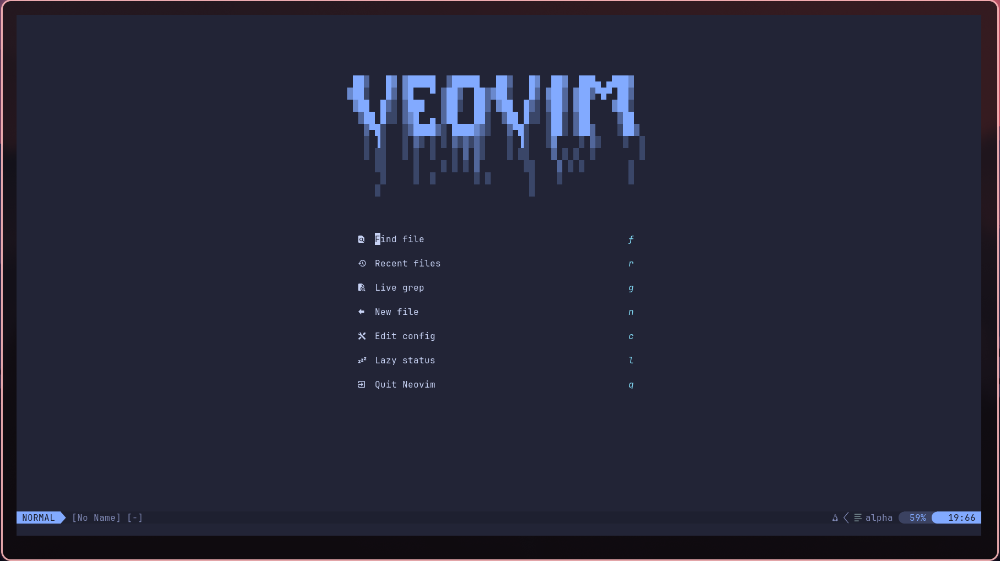
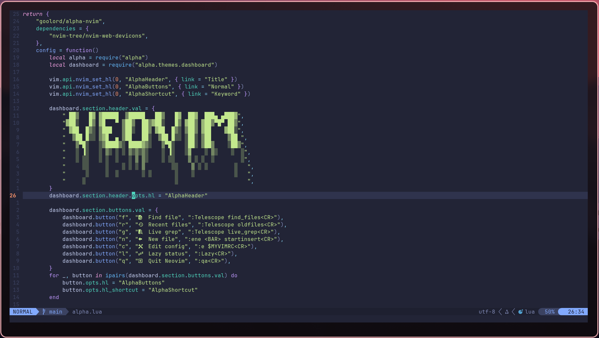
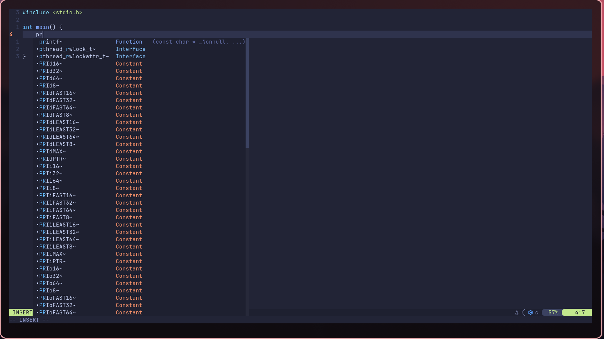

# Personal Neovim Configuration

A Neovim configuration built on **Lazy.nvim**. Crafted for a dark, minimalist, and atmospheric development experience with native LSP, fuzzy finding, and smooth cursor animations.

Feel free to copy, fork, or steal any part of this for your own setup. No permission needed, no attribution required, just take what's useful.

---

## Highlights

- **Fast startup** - lazy-loaded plugins via `lazy.nvim`
- **Native LSP** - configured language servers with sane defaults
- **Fuzzy finding** - Telescope for files, grep, and buffers
- **File tree** - Neo-tree side panel for project navigation
- **Atmospheric theme** - TokyoNight/Catcuppin based colorscheme, tuned for low-light coding
- **Smooth UX** - smear-cursor animations, clean statusline, dashboard home screen
- **Fully modular** - every plugin lives in its own file for easy editing

---

## Previews

**Modular Alpha-nvim Dashboard**


**Atmospheric Colorscheme & Visual Syntax Highlighting**


**Auto Completion**


---

## Installation

> **Requirements:** Neovim **0.9+**, `git`, a [Nerd Font](https://www.nerdfonts.com/) for icons, and `ripgrep` for Telescope live grep.

1. **Back up your existing config** (if you have one):
   ```bash
   mv ~/.config/nvim ~/.config/nvim.bak
   ```

2. **Clone this repository:**
   ```bash
   git clone https://github.com/<your-username>/<your-repo>.git ~/.config/nvim
   ```

3. **Launch Neovim** - `lazy.nvim` will bootstrap itself and install all plugins automatically:
   ```bash
   nvim
   ```

4. Once plugins finish installing, restart Neovim and you're good to go.

---

## Plugin Overview

| Module | Purpose |
|---|---|
| `alpha.lua` | Custom dashboard/home screen shown on startup |
| `autopairs.lua` | Auto-closes brackets, quotes, and parens |
| `colorscheme.lua` | Dark, atmospheric theme configuration |
| `comment.lua` | Fast line/block commenting |
| `lsp.lua` | LSP server setup, diagnostics, and keymaps |
| `lualine.lua` | Minimal, informative statusline |
| `neo-tree.lua` | Sidebar file explorer |
| `smear-cursor.lua` | Animated cursor trail effect |
| `syntax.lua` | Treesitter-powered syntax highlighting |
| `telescope.lua` | Fuzzy file/grep/buffer search |

---

## Keymaps

Custom keybindings live in [`lua/config/keymaps.lua`](lua/config/keymaps.lua). Check there for the full, up-to-date list.

---

## Customization

Everything is modular by design:

- Add a new plugin → drop a new file in `lua/plugins/`
- Change an option → edit `lua/config/options.lua`
- Remap a key → edit `lua/config/keymaps.lua`

`lazy.nvim` will pick up new plugin files automatically on next launch.

---

## License

This configuration is **free to copy, modify, and use** for any purpose, no license file, no attribution.

---

## Acknowledgements

Built on top of the excellent work from the Neovim plugin ecosystem, including `lazy.nvim`, `telescope.nvim`, `neo-tree.nvim`, and the TokyoNight/Catpuccin colorscheme.
